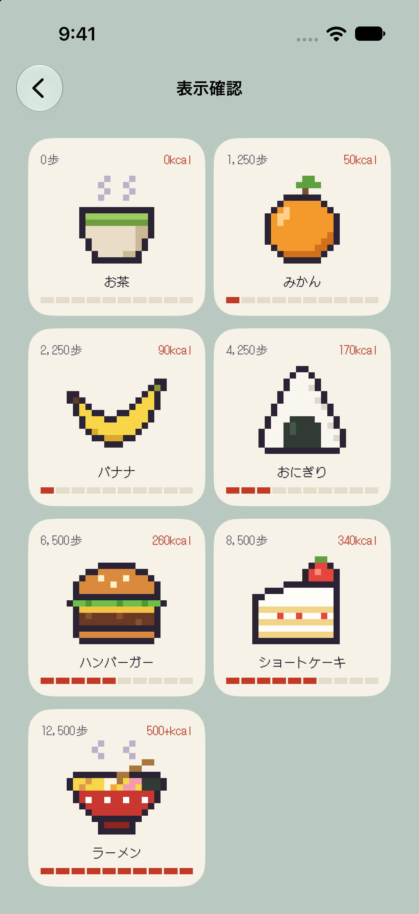
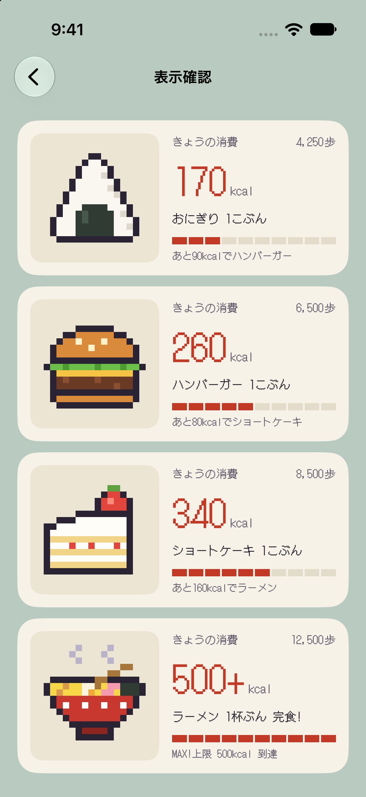
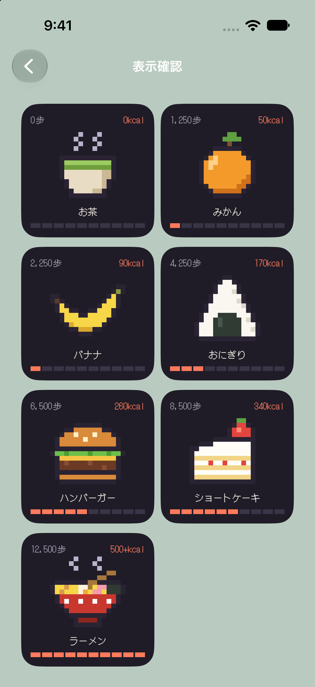

# あるいてごはん（Food-Cal）

歩いた分のカロリーを、食べもののドット絵で見せるiOSウィジェットです。歩くほど、お茶からラーメンまで7段階でごはんが変わります。


| 小                                           | 中                                        | ダークモード                                |
| ------------------------------------------- | ---------------------------------------- | ------------------------------------- |
|  |  |  |


## 計算

```text
kcal = round(歩数 × 体重kg × 0.04 ÷ 60)
```

歩数と体重はHealthKitから読みます。ヘルスケアに体重がなければアプリで入力します。


| ごはん     | 開始kcal |
| ------- | ------ |
| お茶      | 0      |
| みかん     | 50     |
| バナナ     | 90     |
| おにぎり    | 170    |
| ハンバーガー  | 260    |
| ショートケーキ | 340    |
| ラーメン    | 500    |


